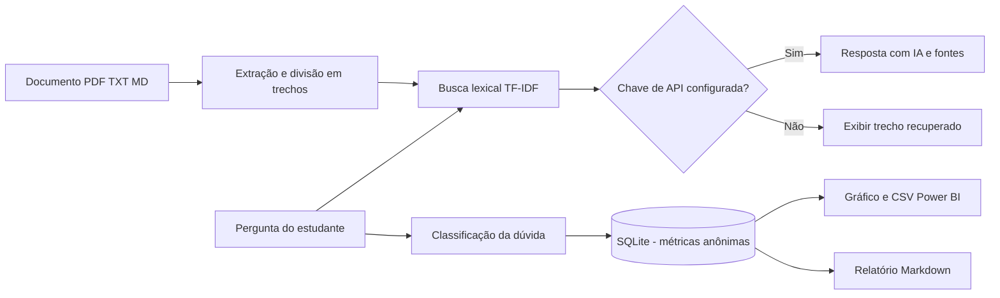

# MonitorIA — Assistente Inteligente para Monitoria de Cálculo II

**MVP 0.1 • Projeto autoral de portfólio de João Pedro Cardoso Ribeiro**

Protótipo para consultar materiais de estudo, responder perguntas com referência aos documentos, classificar os assuntos mais procurados e gerar indicadores de uso. Pensado como demonstração de competências para a trilha **AI Builder** do iFood, mas **não é um produto do iFood** nem um serviço oficial da UFSJ.

## Funcionalidades já implementadas

- Carrega materiais próprios em `.pdf` (com texto extraível), `.txt` ou `.md`.
- Recupera passagens relacionadas à pergunta por meio de TF-IDF lexical local.
- Com chave de API, a IA generativa elabora respostas usando os trechos recuperados e identifica as fontes.
- Sem chave, há **modo demonstração**, com exibição dos trechos encontrados; **não** há geração de respostas por IA.
- Registra somente **data, assunto, modo e quantidade de fontes**; não guarda textos das perguntas nem identidade de estudantes.
- Mostra gráficos de temas mais frequentes, exporta CSV compatível com Power BI e cria relatório em Markdown.
- Script separado permite **gerar relatório periodicamente** por agendamento externo.

## Como executar (Windows, macOS ou Linux)

1. Instale **Python 3.10 ou superior**.
2. Extraia o ZIP, abra o terminal na pasta `MonitorIA_CalculoII`.
3. Crie um ambiente virtual e instale as bibliotecas:

```bash
python -m venv .venv
# Windows PowerShell:
.venv\Scripts\Activate.ps1
# macOS/Linux:
# source .venv/bin/activate
pip install -r requirements.txt
```

4. (Opcional) Copie `.env.example` para `.env` e preencha a `OPENAI_API_KEY` obtida na sua conta da API. **A API pode ter custos separados do plano ChatGPT.** Mantenha a chave em segredo. Se não tiver chave, pule essa etapa.
5. Execute:

```bash
streamlit run app.py
```

6. Abra o endereço local indicado no terminal, normalmente `http://localhost:8501`.

> Dica: em alguns computadores use `py -m streamlit run app.py` ou `python -m streamlit run app.py` se o comando `streamlit` não for reconhecido.

## Roteiro de demonstração em 3 minutos

1. Abra **Materiais**: há quatro documentos demonstrativos **originais e fictícios quanto à origem institucional**; não representam apostilas oficiais da UFSJ.
2. Em **Assistente**, pergunte: `Como funciona integração por partes?`.
3. Veja o trecho consultado; se a API estiver configurada, veja a resposta gerada pela IA.
4. Pergunte `Como calcular uma integral dupla?` e `Como identificar convergência de séries?`.
5. Abra **Indicadores**, veja o ranking, baixe CSV para Power BI e o relatório Markdown.
6. Em **Exemplo de indicadores fictícios**, veja números pré-gerados **claramente identificados como simulados**. Nunca apresente esses números como resultados de uso real.

## Como gerar relatórios por automação

Depois de algumas perguntas, rode na pasta raiz:

```bash
python scripts/gerar_relatorio.py
```

Isso cria `exports/relatorio_AAAA-MM-DD.md` e `exports/monitoria_indicadores.csv`. Para automação periódica, pode-se agendar o comando pelo Agendador de Tarefas (Windows), cron (Linux/macOS) ou integrar um gatilho no n8n em uma próxima versão. **Não existe um agendamento ativo nesta versão.**

## Arquitetura



Arquivos principais:

- `app.py`: interface Streamlit e execução do fluxo.
- `core.py`: leitura dos materiais, indexação, busca, classificação e chamada de IA.
- `storage.py`: armazenamento de indicadores, exportação e relatório.
- `scripts/gerar_relatorio.py`: geração de relatórios via comando.
- `tests/test_core.py`: testes automatizados.

## Testes

```bash
python -m unittest discover -s tests -v
```

## Cuidados, limitações e próximas etapas

- **Segurança:** protótipo local para demonstração. Sem autenticação, controle de usuários ou proteção adicional de arquivos. Não envie dados de estudantes, documentos privados, provas restritas nem dados pessoais.
- Com IA ligada, pergunta e trechos selecionados são enviados à API. Verifique consentimentos e políticas de dados antes de qualquer uso real.
- A busca é **lexical**, não semântica; sinônimos e notação matemática podem ter recuperação limitada.
- A qualidade pedagógica depende dos materiais. Revise cálculos e explicações; o assistente não substitui o monitor ou docente.
- O registro é anônimo em relação à identidade, mas a infraestrutura local ainda precisa ser protegida.
- Melhorias previstas: busca por embeddings, testes de perguntas/respostas, ferramenta n8n para disparos de relatórios, instalação online segura, interface de feedback e autenticação.

## Como apresentar no currículo (quando você testar e dominar a versão)

> **Projeto pessoal — MonitorIA (protótipo)**: desenvolvimento de assistente acadêmico com busca de informações em documentos e respostas com IA generativa (via API), classificação de dúvidas e painel de indicadores, com exportação CSV e relatórios automatizáveis. Tecnologias: Python, Streamlit, SQLite, OpenAI API (se ativada) e Power BI (após realizar a integração).

Adapte o texto à sua experiência real. Não declare uso de API, integração Power BI ou automação agendada antes de executá-los.
